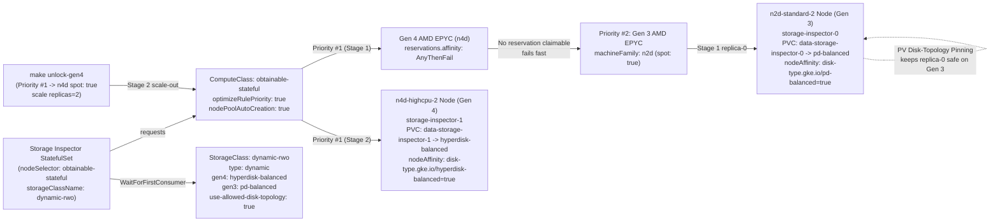

# Designing for stateful compute obtainability on GKE 1.37 across VM generations with dynamic-rwo

In [Part 1 (`BLOG-01-MULTI-ARCH.md`)](BLOG-01-MULTI-ARCH.md), we looked at how stateless Deployments can span x86 (`n4d`, `n4`) and Google Axion Arm64 (`n4a`, `c4a`) inside a single GKE 1.37 `ComputeClass` using **Architecture Taint Suppression**, **Fail-Fast Reservation Affinity**, and **Active Migration**.

Stateful workloads with `ReadWriteOnce` (`RWO`) block volumes run into a different wall when you build an **Obtainability Ladder** across multiple Compute Engine VM generations. Suppose your platform prefers 4th-generation VMs (`n4d`, `n4`, `n4a`, `c4`) and falls back to 3rd- or 2nd-generation VMs (`n2d`, `n2`, `e2`) when 4th-generation capacity is unavailable in a zone. As soon as a `StatefulSet` requests a PersistentVolumeClaim (`PVC`), three storage rules get in the way:

1. **4th-generation VMs only attach Google Cloud Hyperdisk.** Machine series like `n4`, `n4d`, `n4a`, `c4`, `c4a`, and `c4d` support `hyperdisk-balanced`, `hyperdisk-extreme`, and `hyperdisk-throughput`. They cannot attach legacy Persistent Disks (`pd-balanced`, `pd-ssd`, `pd-standard`).
2. **2nd- and 3rd-generation VMs only attach Persistent Disk for general RWO block storage.** Machine series like `n2`, `n2d`, `e2`, `c2`, `c2d`, and `t2d` use `pd-balanced`, `pd-ssd`, or `pd-standard`, and do not support `hyperdisk-balanced`.
3. **Bound PersistentVolumes cannot morph in place between Persistent Disk and Hyperdisk.** Once a `PersistentVolume` (`PV`) is provisioned as `pd-balanced` on a 3rd-generation fallback node, that disk cannot attach to a 4th-generation node. If **Active Migration** (`activeMigration.optimizeRulePriority: true`) blindly drained the 3rd-generation node when 4th-generation capacity recovered, the Pod would sit stuck in `ContainerCreating` or `Pending` because its `pd-balanced` volume cannot attach to a Hyperdisk-only VM.

If a `StatefulSet` uses GKE's default `standard-rwo` `StorageClass` (`parameters.type: pd-balanced`), its Pods can never schedule onto 4th-generation nodes. If it hardcodes a `hyperdisk-balanced` `StorageClass`, falling back to 3rd-generation `n2d` or `n2` nodes during a 4th-generation stockout leaves Pods stuck `Pending`.

GKE solves all three problems when you pair a cross-generation `ComputeClass` with GKE's pre-installed `dynamic-rwo` `StorageClass`:

- **Dynamic Block Storage Selection (`StorageClass/dynamic-rwo`)** configures `provisioner: pd.csi.storage.gke.io` with `volumeBindingMode: WaitForFirstConsumer`, `parameters.type: dynamic`, `hyperdisk-type: hyperdisk-balanced`, and `pd-type: pd-balanced`. Instead of picking a disk type up front, the CSI driver waits until your `ComputeClass` **Obtainability Ladder** selects a concrete node, inspects that node's VM generation, and automatically creates `hyperdisk-balanced` on 4th-generation VMs (`n4d`, `n4`, `n4a`, `c4`) or `pd-balanced` on 2nd- and 3rd-generation VMs (`n2d`, `n2`, `e2`).
- **PV Disk-Topology Pinning (`use-allowed-disk-topology: "true"`)** stamps `disk-type.gke.io/pd-balanced: "true"` or `disk-type.gke.io/hyperdisk-balanced: "true"` into `spec.nodeAffinity` on each dynamically provisioned `PersistentVolume`. Once a replica's PVC is bound to a concrete disk, **PV Disk-Topology Pinning** constrains that specific Pod replica to VM generations that can attach its existing disk. **Active Migration** respects that topology boundary and leaves existing `pd-balanced` replicas undisturbed on 3rd-generation nodes, while newly scaled replicas and new PVCs dynamically claim newly unlocked 4th-generation nodes with `hyperdisk-balanced`.
- **Fail-Fast Reservation Affinity (`reservations.affinity: AnyThenFail`)** and **Node Pool Auto-Creation (`nodePoolAutoCreation.enabled: true`)** let the `ComputeClass` evaluate reserved 4th-generation capacity first, fall through immediately to 3rd-generation Spot capacity when no reservation is available, and provision node pools on demand.

We added **Demo 02 (`02-stateful-storage`)** to [github.com/gke-demos/compute-obtainability](https://github.com/gke-demos/compute-obtainability) to test this workflow end to end on a live GKE `v1.37.0-gke.3503000` cluster. A `StatefulSet` (**Storage Inspector**) starts in Stage 1 by failing fast past an unclaimable 4th-generation `n4d` reservation, lands on a 3rd-generation AMD EPYC Milan `n2d-standard-2` Spot node (`AMD EPYC 7B13`) where `dynamic-rwo` provisions a `10Gi` `pd-balanced` volume for `storage-inspector-0`, and then scales out in Stage 2 (`make unlock-gen4`) onto a 4th-generation AMD EPYC Turin `n4d-highcpu-2` Spot node (`AMD EPYC 9B45`) where `dynamic-rwo` provisions a `10Gi` `hyperdisk-balanced` volume for `storage-inspector-1` in 86 seconds while `storage-inspector-0` stays safely pinned to its `n2d-standard-2` node.

## How cross-generation stateful storage options compare

| Capability | `standard-rwo` (`pd-balanced`) | Custom `hyperdisk-balanced` `StorageClass` | `dynamic-rwo` (**Dynamic Block Storage Selection**) |
| :--- | :--- | :--- | :--- |
| Scheduling onto 4th-Gen VMs (`n4d`, `n4`, `n4a`, `c4`) | Fails (`pd-balanced` cannot attach to Gen 4 VMs) | Succeeds (`hyperdisk-balanced` attaches) | Succeeds (provisions `hyperdisk-balanced` automatically) |
| Falling back to 3rd-Gen VMs (`n2d`, `n2`, `e2`) | Succeeds (`pd-balanced` attaches) | Fails (`hyperdisk-balanced` cannot attach to Gen 3 VMs) | Succeeds (provisions `pd-balanced` automatically) |
| PV `spec.nodeAffinity` stamped at provisioning | Zone topology only (`topology.gke.io/zone`) | Zone topology only (`topology.gke.io/zone`) | Zone topology + **PV Disk-Topology Pinning** (`disk-type.gke.io/<disk-type>: "true"`) |
| Behavior under **Active Migration** (`optimizeRulePriority: true`) | Blocks Gen 4 migration | Blocks Gen 3 fallback | Keeps bound `pd-balanced` replicas safe on Gen 3 while new replicas provision `hyperdisk-balanced` on Gen 4 |

## What we are building

Demo 02 runs inside the `obtainability-stateful` namespace and pairs `ComputeClass/obtainable-stateful` with GKE's built-in `StorageClass/dynamic-rwo`.



**Stage 1 (`manifests/02-stateful-storage/01-computeclass-fallback.yaml`).** Priority #1 requests 4th-generation AMD EPYC `n4d` (which only supports Hyperdisk) with `reservations.affinity: AnyThenFail`. With no `n4d` reservation available in the project, Cluster Autoscaler immediately skips Priority #1 and falls back to Priority #2 (`machineFamily: n2d`, `spot: true`). GKE provisions a 3rd-generation `n2d-standard-2` Spot node via **Node Pool Auto-Creation**.

**Storage Inspector (`manifests/02-stateful-storage/02-storage-inspector.yaml`).** A zero-build `alpine:3.20` `StatefulSet` requests `cloud.google.com/compute-class: obtainable-stateful` and a `10Gi` `ReadWriteOnce` volume from `storageClassName: dynamic-rwo`. Because `dynamic-rwo` uses `WaitForFirstConsumer`, `pd.csi.storage.gke.io` waits until `storage-inspector-0` is scheduled onto the Gen 3 `n2d-standard-2` node, sees that `n2d` supports Persistent Disk, creates a `pd-balanced` volume, and stamps `disk-type.gke.io/pd-balanced: "true"` onto the PV's `spec.nodeAffinity`.

**Stage 2 (`manifests/02-stateful-storage/03-computeclass-obtainable-gen4.yaml` + `make unlock-gen4`).** Running `make unlock-gen4` updates Priority #1 of `ComputeClass/obtainable-stateful` to obtainable Gen 4 `n4d` Spot (`spot: true`) and scales `StatefulSet/storage-inspector` to `replicas: 2`. Because `storage-inspector-1` has a fresh unbound PVC (`data-storage-inspector-1`) and hostname `podAntiAffinity` against `storage-inspector-0`, GKE provisions a Priority #1 Gen 4 `n4d-highcpu-2` Spot node and `dynamic-rwo` provisions a `hyperdisk-balanced` volume (`disk-type.gke.io/hyperdisk-balanced: "true"`). At the same time, **PV Disk-Topology Pinning** keeps `storage-inspector-0` pinned to its Gen 3 `n2d-standard-2` node with zero Pod restarts.

## Follow along on your own cluster

You can run the entire Demo 02 cross-generation stateful workflow in four commands on any GKE 1.37+ cluster.

### Step 1: Inspect `StorageClass/dynamic-rwo` and deploy Stage 1

Every GKE 1.37 cluster pre-installs `StorageClass/dynamic-rwo`. You can inspect its parameters with `kubectl get storageclass dynamic-rwo -o yaml`:

```yaml
apiVersion: storage.k8s.io/v1
kind: StorageClass
metadata:
  name: dynamic-rwo
parameters:
  hyperdisk-type: hyperdisk-balanced
  pd-type: pd-balanced
  type: dynamic
  use-allowed-disk-topology: "true"
provisioner: pd.csi.storage.gke.io
reclaimPolicy: Delete
volumeBindingMode: WaitForFirstConsumer
allowVolumeExpansion: true
```

Next, check `manifests/02-stateful-storage/01-computeclass-fallback.yaml`:

```yaml
apiVersion: cloud.google.com/v1
kind: ComputeClass
metadata:
  name: obtainable-stateful
spec:
  description: >-
    Stage 1 Cross-Generation Stateful Obtainability Ladder preferring Gen 4
    (n4d with Fail-Fast Reservation Affinity) and falling back to Gen 3 (n2d
    Spot, n2 On-Demand) paired with StorageClass/dynamic-rwo.
  nodePoolAutoCreation:
    enabled: true
  activeMigration:
    optimizeRulePriority: true
  autoscalingPolicy:
    consolidationDelayMinutes: 1
    consolidationThreshold: 70
  priorities:
    # Priority #1: Claim an existing 4th-Gen AMD EPYC (n4d, Hyperdisk-only) reservation
    # if available; otherwise fail fast (AnyThenFail) instead of billing On-Demand n4d.
    - machineFamily: n4d
      reservations:
        affinity: AnyThenFail
    # Priority #2: Fall back to obtainable 3rd-Gen AMD EPYC (n2d, Persistent Disk) Spot capacity.
    - machineFamily: n2d
      spot: true
    # Priority #3: Last-resort 3rd-Gen Intel (n2, Persistent Disk) On-Demand capacity.
    - machineFamily: n2
      spot: false
  whenUnsatisfiable: DoNotScaleUp
```

And look at the `StatefulSet` spec in `manifests/02-stateful-storage/02-storage-inspector.yaml`, which pairs `cloud.google.com/compute-class: obtainable-stateful` with `storageClassName: dynamic-rwo`:

```yaml
apiVersion: apps/v1
kind: StatefulSet
metadata:
  name: storage-inspector
  namespace: obtainability-stateful
spec:
  serviceName: storage-inspector
  replicas: 1
  podManagementPolicy: Parallel
  selector:
    matchLabels:
      app: storage-inspector
  template:
    metadata:
      labels:
        app: storage-inspector
    spec:
      serviceAccountName: storage-inspector
      nodeSelector:
        cloud.google.com/compute-class: obtainable-stateful
      affinity:
        podAntiAffinity:
          requiredDuringSchedulingIgnoredDuringExecution:
            - labelSelector:
                matchLabels:
                  app: storage-inspector
              topologyKey: kubernetes.io/hostname
  volumeClaimTemplates:
    - metadata:
        name: data
      spec:
        accessModes:
          - ReadWriteOnce
        storageClassName: dynamic-rwo
        resources:
          requests:
            storage: 10Gi
```

Deploy Stage 1 with `make apply-stateful`:

```bash
make apply-stateful
```

### Step 2: Watch the stateful obtainability observer

In one terminal pane, run `make watch-stateful` (or `make status-stateful` for a single snapshot) to inspect the `ComputeClass` priority ladder, `StorageClass/dynamic-rwo` parameters, provisioned nodes with their VM generation (`Gen3` vs `Gen4`), bound PVCs/PVs with their resolved disk types and `disk-type.gke.io/*` topology affinities, and running **Storage Inspector** replicas:

```bash
make watch-stateful
```

Once Stage 1 scale-up completes, `storage-inspector-0` is running on an auto-created 3rd-generation `n2d-standard-2` Spot node (`Gen3`, `AMD EPYC 7B13`) with `data-storage-inspector-0` bound to a `pd-balanced` volume (`disk-type.gke.io/pd-balanced=true`).

### Step 3: Unlock Gen 4 `n4d` Spot and scale out (`make unlock-gen4`)

Now look at `manifests/02-stateful-storage/03-computeclass-obtainable-gen4.yaml`, which unlocks Priority #1 to obtainable 4th-generation AMD EPYC `n4d` Spot (`spot: true`):

```yaml
  priorities:
    # Priority #1: Obtainable 4th-Gen AMD EPYC (n4d, Hyperdisk-only) Spot capacity.
    # Newly scaled StatefulSet replicas provision hyperdisk-balanced volumes on n4d,
    # while existing Gen 3 (n2d, pd-balanced) replicas remain safely pinned via
    # PV Disk-Topology Pinning (use-allowed-disk-topology: "true").
    - machineFamily: n4d
      spot: true
    # Priority #2: Secondary 3rd-Gen AMD EPYC (n2d, Persistent Disk) Spot capacity.
    - machineFamily: n2d
      spot: true
    # Priority #3: Last-resort 3rd-Gen Intel (n2, Persistent Disk) On-Demand capacity.
    - machineFamily: n2
      spot: false
```

Run `make unlock-gen4` in your second terminal to apply `03-computeclass-obtainable-gen4.yaml` and scale `StatefulSet/storage-inspector` to `replicas=2`:

```bash
make unlock-gen4
```

Watch the top observer pane as GKE auto-creates a Gen 4 `n4d-highcpu-2` Spot node, `dynamic-rwo` dynamically provisions a `hyperdisk-balanced` PV (`disk-type.gke.io/hyperdisk-balanced=true`) for `data-storage-inspector-1`, and `storage-inspector-1` starts on `Gen4` `n4d-highcpu-2` (`AMD EPYC 9B45`) while `storage-inspector-0` remains running on `Gen3` `n2d-standard-2` (`AMD EPYC 7B13`, `pd-balanced`) without interruption.

When you are finished, tear down all Demo 02 resources (including PVCs) with `make clean-stateful` or `make clean`:

```bash
make clean
```

## Live demo on GKE 1.37

The recording below was captured from a live run on a GKE `v1.37.0-gke.3503000` cluster. The top pane runs `./hack/watch-stateful.sh --interval 2` while the bottom pane inspects `StorageClass/dynamic-rwo` and streams `make logs-stateful` in Stage 1 (`pod=storage-inspector-0 VM_GEN=Gen3 MACHINE=n2d-standard-2 PROV=spot PVC=data-storage-inspector-0 DISK_TYPE=pd-balanced`), runs `make unlock-gen4`, watches GKE provision a Gen 4 `n4d-highcpu-2` Spot node and bind `data-storage-inspector-1` to `hyperdisk-balanced` (`disk-type.gke.io/hyperdisk-balanced=true`), and runs `make logs-stateful` a second time to show `storage-inspector-0` (`Gen3`, `n2d-standard-2`, `pd-balanced`) and `storage-inspector-1` (`Gen4`, `n4d-highcpu-2`, `hyperdisk-balanced`) side by side.


*Watch the high-resolution MP4 recording: [assets/02-stateful-storage-demo.mp4](https://github.com/gke-demos/compute-obtainability/raw/main/assets/02-stateful-storage-demo.mp4)*

| Phase | Timestamp (UTC) | Elapsed from `make unlock-gen4` | Active Node(s) & Silicon | Bound PVC(s) & Resolved Disk Type | PV `nodeAffinity` (**PV Disk-Topology Pinning**) |
| :--- | :--- | :--- | :--- | :--- | :--- |
| Stage 1 fallback complete (`AnyThenFail` skipped Priority #1 `n4d`) | `17:49:40Z` | `-2s` | `n2d-standard-2` (`Gen3` Spot, `AMD EPYC 7B13`) | `data-storage-inspector-0` -> `pd-balanced` | `disk-type.gke.io/pd-balanced=true` |
| `make unlock-gen4` (`Priority #1 -> n4d spot: true`, `replicas=2`) | `17:49:42Z` | `0s` | `n2d-standard-2` (`Gen3` Spot); `storage-inspector-1` `Pending` | `data-storage-inspector-0` (`Bound`), `data-storage-inspector-1` (`Pending`) | `WaitForFirstConsumer` awaits Gen 4 node |
| Gen 4 `n4d-highcpu-2` Spot node registers & reaches `Ready` | `17:50:44Z` | `+59s` | `n2d-standard-2` (`Gen3` `AMD EPYC 7B13`) + `n4d-highcpu-2` (`Gen4` `AMD EPYC 9B45`) | `data-storage-inspector-1` provisioning on `n4d-highcpu-2` | CSI driver inspects `n4d-highcpu-2` topology |
| `data-storage-inspector-1` binds to `hyperdisk-balanced` & `storage-inspector-1` reaches `1/1 Running` | `17:51:12Z` | `+86s` | `storage-inspector-0` on `n2d-standard-2` (`Gen3`) + `storage-inspector-1` on `n4d-highcpu-2` (`Gen4`) | `data-storage-inspector-0` (`pd-balanced`) + `data-storage-inspector-1` (`hyperdisk-balanced`) | `disk-type.gke.io/pd-balanced=true` (PV 0) & `disk-type.gke.io/hyperdisk-balanced=true` (PV 1) |

## A few things to keep in mind

When you combine cross-generation `ComputeClass` ladders with stateful workloads in production, keep three operational details in mind (covered in detail in [TROUBLESHOOTING.md](TROUBLESHOOTING.md) and [ADR-0004](docs/adr/0004-dynamic-rwo-and-pv-topology-pinning-across-vm-generations.md)):

**Always use `volumeBindingMode: WaitForFirstConsumer` with `parameters.type: dynamic` (`StorageClass/dynamic-rwo`).** If a `StorageClass` uses `Immediate` binding or hardcodes `pd-balanced` or `hyperdisk-balanced`, the volume is created before the Kubernetes scheduler and Cluster Autoscaler know which priority rule in your **Obtainability Ladder** has capacity in the zone. With `dynamic-rwo`, `pd.csi.storage.gke.io` waits until a node is selected and then creates `hyperdisk-balanced` for 4th-generation VMs (`n4d`, `n4`, `n4a`, `c4`) or `pd-balanced` for 2nd- and 3rd-generation VMs (`n2d`, `n2`, `e2`). See [Troubleshooting #4](TROUBLESHOOTING.md#4-cross-generation-stateful-storage-with-dynamic-rwo-pv-disk-topology-pinning-and-podantiaffinity) and [ADR-0004](docs/adr/0004-dynamic-rwo-and-pv-topology-pinning-across-vm-generations.md).

**PV Disk-Topology Pinning protects existing replicas from impossible cross-generation disk migrations.** Setting `use-allowed-disk-topology: "true"` (enabled by default on `dynamic-rwo`) causes the PD CSI driver to stamp `disk-type.gke.io/pd-balanced: "true"` or `disk-type.gke.io/hyperdisk-balanced: "true"` into `spec.nodeAffinity` on the `PersistentVolume` at creation time. When 4th-generation capacity becomes obtainable again, Cluster Autoscaler's **Active Migration** loop (`optimizeRulePriority: true`) sees that `storage-inspector-0`'s bound PV requires `disk-type.gke.io/pd-balanced` and keeps `storage-inspector-0` running safely on its 3rd-generation `n2d` node (`metadata.uid` stays unchanged), while new replicas (`storage-inspector-1`) schedule onto 4th-generation `n4d` nodes with `hyperdisk-balanced`. If you later want to move an existing `pd-balanced` replica onto Hyperdisk, take a `VolumeSnapshot` and restore its PVC on a 4th-generation node.

**Pair `podManagementPolicy: Parallel` with hostname `podAntiAffinity` for distributed stateful services.** Without `podAntiAffinity` on `kubernetes.io/hostname`, scaling a `StatefulSet` from 1 to 2 replicas when your existing 3rd-generation fallback node still has spare CPU and memory will schedule `storage-inspector-1` onto that same 3rd-generation node and create a second `pd-balanced` disk, instead of triggering Cluster Autoscaler to provision a Priority #1 4th-generation node. Adding `podAntiAffinity` across `kubernetes.io/hostname` guarantees each stateful replica gets its own failure domain and evaluates the top of the **Obtainability Ladder** on scale-out. See [Troubleshooting #4](TROUBLESHOOTING.md#4-cross-generation-stateful-storage-with-dynamic-rwo-pv-disk-topology-pinning-and-podantiaffinity) and [ADR-0004](docs/adr/0004-dynamic-rwo-and-pv-topology-pinning-across-vm-generations.md).
