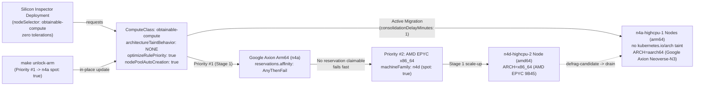
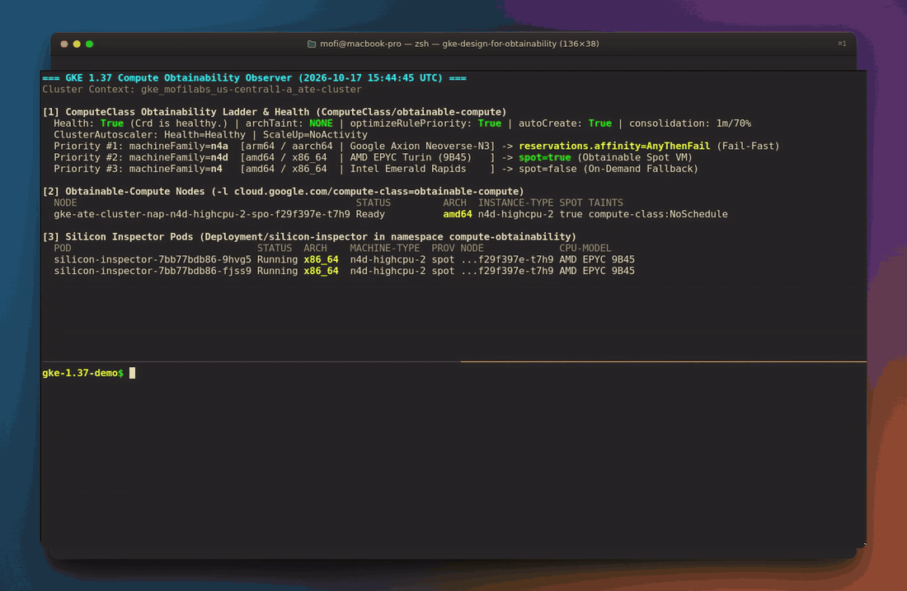

# Designing for compute obtainability on GKE 1.37 across x86 and Google Axion Arm64

Building multi-architecture container images used to be the hard part of running workloads across x86 and Arm. Today, `docker buildx` is part of standard CI pipelines, and nearly every common upstream base image (`alpine`, `python`, `golang`, `nginx`, `redis`, `distroless`) publishes an OCI image index supporting both `linux/amd64` and `linux/arm64`.

Even with multi-architecture images ready to go, most Kubernetes clusters still pin each workload to a single machine family and CPU architecture. When a regional demand spike hits or a Spot pool runs low on capacity, scale-up stalls on `ZONE_RESOURCE_POOL_EXHAUSTED` while plenty of capacity sits unused in another machine family or architecture in the exact same zone.

If you tried to fix this on Google Kubernetes Engine by putting Google Axion Arm64 (`n4a`, `c4a`) and x86 (`n4d`, `n4`) rules into a single `ComputeClass` priority list, you used to hit three roadblocks:

1. **Default Arm64 node taints blocked unmodified Pods.** GKE taints Arm64 nodes with `kubernetes.io/arch=arm64:NoSchedule` by default. Unless you edited every Deployment manifest in your cluster to add a matching `toleration`, your Pods could never schedule or fail over onto Arm64 nodes.
2. **`AnyBestEffort` reservations silently billed On-Demand VMs.** If you put reserved capacity at Priority #1 with `reservations.affinity: AnyBestEffort` and Spot VMs at Priority #2, running out of reserved capacity caused GKE to spin up On-Demand VMs of the Priority #1 family instead of falling through to Priority #2 Spot VMs.
3. **Workloads stayed stranded on fallback nodes.** Once a shortage passed or preferred capacity became obtainable again, Pods that had fallen back to a secondary machine family stayed there until the next deployment rollout.

GKE 1.37 resolves all three with native `ComputeClass` (`cloud.google.com/v1`) controls:

- **Architecture Taint Suppression** (`nodePoolConfig.taintConfig.architectureTaintBehavior: NONE`) tells GKE to provision Arm64 node pools for that `ComputeClass` without the `kubernetes.io/arch=arm64:NoSchedule` taint, so standard multi-arch Deployments schedule across `x86_64` and `arm64` with zero Pod spec changes.
- **Fail-Fast Reservation Affinity** (`reservations.affinity: AnyThenFail`) claims a reservation if one is available and immediately moves to the next priority rule when none is claimable.
- **Active Migration** (`activeMigration.optimizeRulePriority: true`) with **Node Pool Auto-Creation** (`nodePoolAutoCreation.enabled: true`) continuously reconciles running nodes against your **Obtainability Ladder**, provisioning higher-priority nodes when they become obtainable and draining lower-priority fallback nodes automatically.

I built a zero-build reference repo at [github.com/moficodes/gke-design-for-obtainability](https://github.com/moficodes/gke-design-for-obtainability) to test how these three features behave together on a live GKE `v1.37.0-gke.3503000` cluster. An unmodified `alpine:3.20` Deployment (**Silicon Inspector**) starts by failing fast past an unclaimable reservation, lands on AMD EPYC `x86_64` (`n4d-highcpu-2` Spot), and then live-migrates onto Google Axion `aarch64` (`n4a-highcpu-1` Spot) in 192 seconds after a single `ComputeClass` update.

## How the GKE 1.37 obtainability controls compare

| Capability | Legacy GKE setup | GKE 1.37 `ComputeClass` (`obtainable-compute`) |
| :--- | :--- | :--- |
| Scheduling across `x86_64` and `arm64` | Every Pod spec needs a `kubernetes.io/arch=arm64:NoSchedule` toleration | Platform sets `architectureTaintBehavior: NONE` once on the `ComputeClass` |
| Unfilled reservation at Priority #1 | `AnyBestEffort` silently provisions On-Demand VMs of Priority #1 | `AnyThenFail` fails Priority #1 immediately and advances to Priority #2 Spot |
| Returning to preferred silicon | Manual `kubectl rollout restart` or node cordon/drain | `optimizeRulePriority: true` provisions Priority #1 and drains fallback nodes |
| Node pool provisioning | Pre-created static node pools or cluster-wide NAP | Workload-scoped **Node Pool Auto-Creation** (`nodePoolAutoCreation.enabled: true`) |

## What we are building

To test **Compute Obtainability** deterministically without waiting for a real regional stockout, the repository structures the **Obtainability Ladder** in two stages inside the `compute-obtainability` namespace.



**Stage 1 (`manifests/01-computeclass-fallback.yaml`).** Priority #1 asks for Google Axion Arm64 (`machineFamily: n4a`) with `reservations.affinity: AnyThenFail`. Because our test project has no `n4a` reservation, Cluster Autoscaler evaluates Priority #1, fails fast instead of billing On-Demand `n4a`, and falls back to Priority #2 (`machineFamily: n4d`, `spot: true`). GKE auto-creates an AMD EPYC `n4d` Spot node pool and schedules our **Silicon Inspector** Pods on `x86_64`.

**Silicon Inspector (`manifests/02-silicon-inspector.yaml`).** A 2-replica `alpine:3.20` Deployment selects `cloud.google.com/compute-class: obtainable-compute` with zero `tolerations` and zero `kubernetes.io/arch` selectors. Every 10 seconds, each Pod inspects `uname -m`, `/proc/cpuinfo`, and its node metadata to log the live CPU instruction set (`x86_64` vs `aarch64`), GCE machine type, provisioning model, and silicon model name.

**Stage 2 (`manifests/03-computeclass-obtainable-arm.yaml`).** Running `make unlock-arm` updates Priority #1 of `ComputeClass/obtainable-compute` in place to obtainable Google Axion Arm64 Spot (`machineFamily: n4a`, `spot: true`). Without touching `Deployment/silicon-inspector`, GKE's **Active Migration** loop provisions an untainted `n4a` Arm64 node pool, cordons and drains the `n4d` x86_64 node, and moves both Pods onto `aarch64`.

## Follow along on your own cluster

If you have a GKE 1.37+ cluster, you can run the entire fallback and cross-architecture migration loop in four commands.

Clone the repository first:

```bash
git clone https://github.com/moficodes/gke-design-for-obtainability.git
cd gke-design-for-obtainability
```

### Step 1: Deploy the Stage 1 Obtainability Ladder and Silicon Inspector

First, look at `manifests/01-computeclass-fallback.yaml`:

```yaml
apiVersion: cloud.google.com/v1
kind: ComputeClass
metadata:
  name: obtainable-compute
spec:
  description: >-
    Stage 1 Obtainability Ladder spanning Google Axion Arm64 (n4a) and x86_64
    (n4d, n4) with Architecture Taint Suppression, Fail-Fast Reservation
    Affinity, and Active Migration.
  nodePoolAutoCreation:
    enabled: true
  nodePoolConfig:
    taintConfig:
      architectureTaintBehavior: NONE
  activeMigration:
    optimizeRulePriority: true
  autoscalingPolicy:
    consolidationDelayMinutes: 1
    consolidationThreshold: 70
  priorities:
    # Priority #1: Claim an existing Google Axion Arm64 (n4a) reservation if available;
    # otherwise fail fast (AnyThenFail) instead of billing On-Demand n4a.
    - machineFamily: n4a
      reservations:
        affinity: AnyThenFail
    # Priority #2: Fall back to obtainable AMD EPYC x86_64 (n4d) Spot capacity.
    - machineFamily: n4d
      spot: true
    # Priority #3: Last-resort Intel Emerald Rapids x86_64 (n4) On-Demand capacity.
    - machineFamily: n4
      spot: false
  whenUnsatisfiable: DoNotScaleUp
```

Next, check the Pod template in `manifests/02-silicon-inspector.yaml`. Notice that it only sets `nodeSelector: { cloud.google.com/compute-class: obtainable-compute }` and includes no `tolerations`:

```yaml
apiVersion: apps/v1
kind: Deployment
metadata:
  name: silicon-inspector
  namespace: compute-obtainability
spec:
  replicas: 2
  selector:
    matchLabels:
      app: silicon-inspector
  template:
    metadata:
      labels:
        app: silicon-inspector
    spec:
      serviceAccountName: silicon-inspector
      terminationGracePeriodSeconds: 5
      nodeSelector:
        cloud.google.com/compute-class: obtainable-compute
      containers:
        - name: inspector
          image: alpine:3.20
          resources:
            requests:
              cpu: 500m
              memory: 512Mi
```

Apply both manifests with `make apply`:

```bash
make apply
```

### Step 2: Open the live observer

In one terminal pane, run `make watch` to monitor the `ComputeClass` priority ladder, provisioned nodes, node taints, and live Pod architectures every 5 seconds, or run `make status` for a single snapshot:

```bash
make watch
```

Once Stage 1 scale-up completes, you will see `gke-ate-cluster-nap-n4d-highcpu-2-spo-0711bf09-jccl` (`amd64`, `n4d-highcpu-2`, `spot=true`) running both **Silicon Inspector** Pods on `x86_64` (`AMD EPYC 9B45`).

### Step 3: Unlock Priority #1 Google Axion Arm64 (`make unlock-arm`)

Now inspect `manifests/03-computeclass-obtainable-arm.yaml`, which promotes obtainable Google Axion Arm64 Spot (`machineFamily: n4a`, `spot: true`) to Priority #1:

```yaml
  priorities:
    # Priority #1: Obtainable Google Axion Arm64 (n4a) Spot capacity.
    # With optimizeRulePriority: true and architectureTaintBehavior: NONE, GKE
    # provisions an untainted n4a node pool and actively migrates Pods from n4d.
    - machineFamily: n4a
      spot: true
    # Priority #2: Secondary AMD EPYC x86_64 (n4d) Spot capacity.
    - machineFamily: n4d
      spot: true
    # Priority #3: Last-resort Intel Emerald Rapids x86_64 (n4) On-Demand capacity.
    - machineFamily: n4
      spot: false
```

Apply the Stage 2 `ComputeClass` update in your second terminal:

```bash
make unlock-arm
```

Watch the first terminal as GKE waits for the 1-minute consolidation window, marks the `n4d` node with `autoscaling.gke.io/defrag-candidate`, provisions an `n4a-highcpu-1` (`arm64`) Spot node pool with zero `kubernetes.io/arch` taint, cordons and drains the `n4d` node, and restarts both **Silicon Inspector** Pods on `aarch64` (`Google Axion (Arm Neoverse-N3 0x41/0xd8e)`).

When you are done, clean up the namespace and `ComputeClass` with `make clean`:

```bash
make clean
```

## Live demo on GKE 1.37

If you do not have a cluster handy, the recording below captures the transition on a live GKE `v1.37.0-gke.3503000` cluster (`gke_mofilabs_us-central1-a_ate-cluster`). It starts in the Stage 1 fallback state with both Pods running on `n4d-highcpu-2` (`ARCH=x86_64`, `AMD EPYC 9B45`), executes `make unlock-arm`, tracks the node defragmentation and untainted `n4a-highcpu-1` (`arm64`) node registration in the top observer pane, and verifies the migrated Pods running on Google Axion (`ARCH=aarch64`, `Arm Neoverse-N3 0x41/0xd8e`).



*Watch the high-resolution MP4 recording: [assets/demo.mp4](https://github.com/moficodes/gke-design-for-obtainability/raw/main/assets/demo.mp4)*

| Phase | Timestamp (UTC) | Elapsed from `make unlock-arm` | Active Node(s) | Node Taints | `silicon-inspector` `uname -m` & Silicon |
| :--- | :--- | :--- | :--- | :--- | :--- |
| Stage 1 fallback complete (`AnyThenFail` skipped Priority #1) | `14:41:05Z` | `-2s` | `n4d-highcpu-2` (`amd64` Spot) | `compute-class=obtainable-compute:NoSchedule` | `x86_64` (`AMD EPYC 9B45`) |
| `make unlock-arm` (`Priority #1 -> n4a spot: true`) | `14:41:07Z` | `0s` | `n4d-highcpu-2` (`amd64` Spot) | `compute-class=obtainable-compute:NoSchedule` | `x86_64` (`AMD EPYC 9B45`) |
| Consolidation window ends; CA marks `n4d` as defrag candidate & scales up `n4a` | `14:43:27Z` | `+137s` | `n4d-highcpu-2` (`amd64` Spot) | `defrag-candidate:NoSchedule` added to `n4d` | `x86_64` (`AMD EPYC 9B45`) |
| First `n4a-highcpu-1` (`arm64` Spot) node registers | `14:43:55Z` | `+162s` | `n4a-highcpu-1` (`NotReady`), `n4d-highcpu-2` (`Ready`) | `n4a` has **zero** `kubernetes.io/arch` taint | `x86_64` (`AMD EPYC 9B45`) |
| `n4a-highcpu-1` nodes reach `Ready`; CA cordons & drains `n4d-highcpu-2` | `14:44:09Z` | `+178s` | `2x n4a-highcpu-1` (`Ready`), `n4d-highcpu-2` (`SchedulingDisabled`) | `ToBeDeletedByClusterAutoscaler:NoSchedule` on `n4d` | Pods scheduling onto `arm64` |
| Both **Silicon Inspector** Pods `1/1 Running` on Google Axion Arm64 | `14:44:24Z` | `+192s` | `2x n4a-highcpu-1` (`arm64` Spot) | `compute-class=obtainable-compute:NoSchedule` (no `arch` taint) | `aarch64` (`Google Axion (Arm Neoverse-N3 0x41/0xd8e)`) |

## A few things to keep in mind

When you adopt multi-architecture `ComputeClass` ladders in production, watch out for three details that we documented in the repo's [troubleshooting guide](https://github.com/moficodes/gke-design-for-obtainability/blob/main/TROUBLESHOOTING.md):

**Suppressing the Arm64 taint still isolates the node pool to your `ComputeClass`.** A common concern with setting `architectureTaintBehavior: NONE` is that x86-only Deployments elsewhere in the cluster might accidentally land on the Arm64 nodes with Architecture Taint Suppression and crash with `exec format error`. That does not happen because GKE still applies `cloud.google.com/compute-class=obtainable-compute:NoSchedule` to every node in the class, and only injects the matching `compute-class` toleration into Pods that explicitly select `obtainable-compute`. See [Troubleshooting #1](https://github.com/moficodes/gke-design-for-obtainability/blob/main/TROUBLESHOOTING.md#1-architecturetaintbehavior-none-vs-cloudgooglecomcompute-class-isolation-taints) and [ADR-0001](https://github.com/moficodes/gke-design-for-obtainability/blob/main/docs/adr/0001-architecture-taint-none-over-pod-tolerations.md).

**Use `AnyThenFail` instead of `AnyBestEffort` when chaining Reservations into Spot.** If Priority #1 targets reserved capacity and Priority #2 targets Spot VMs, setting `reservations.affinity: AnyBestEffort` tells Cluster Autoscaler to provision On-Demand VMs of the Priority #1 machine family as soon as the reservation is full. Setting `reservations.affinity: AnyThenFail` forces Priority #1 to fail fast when no reservation is available so Cluster Autoscaler immediately evaluates Priority #2. See [Troubleshooting #2](https://github.com/moficodes/gke-design-for-obtainability/blob/main/TROUBLESHOOTING.md#2-reservationsaffinity-anythenfail-vs-anybesteffort-on-priority-1) and [ADR-0002](https://github.com/moficodes/gke-design-for-obtainability/blob/main/docs/adr/0002-anythenfail-reservation-for-deterministic-fallback-and-active-migration.md).

**In-place `ComputeClass` updates trigger Active Migration after `consolidationDelayMinutes`.** You do not need to restart or scale your Deployment when updating `spec.priorities` on a `ComputeClass` (`metadata.generation` on `Deployment/silicon-inspector` stayed at `1` throughout our run). Cluster Autoscaler waits for `autoscalingPolicy.consolidationDelayMinutes` (`1` minute in our manifest), taints the lower-priority node with `autoscaling.gke.io/defrag-candidate`, brings up the higher-priority node pool, and only cordons the old node with `ToBeDeletedByClusterAutoscaler` once the replacement nodes are `Ready`. Also keep in mind that on clusters with GKE Workload Identity (`GKE_METADATA`), the metadata proxy blocks raw GCE `instance/machine-type` endpoints, so reading `node.kubernetes.io/instance-type` and `cloud.google.com/gke-spot` from the Kubernetes Node API is a clean fallback. See [Troubleshooting #3](https://github.com/moficodes/gke-design-for-obtainability/blob/main/TROUBLESHOOTING.md#3-in-place-active-migration-timing-defrag-candidate-taints-and-gke_metadata-node-labels) and [ADR-0003](https://github.com/moficodes/gke-design-for-obtainability/blob/main/docs/adr/0003-in-place-active-migration-and-defrag-lifecycle.md).

All the manifests, the observer script, and the verification harnesses live in [github.com/moficodes/gke-design-for-obtainability](https://github.com/moficodes/gke-design-for-obtainability).
