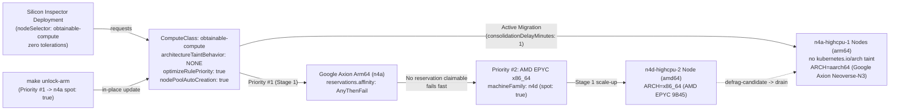

# Designing for compute obtainability on GKE 1.37

Zero-build reference for **Compute Obtainability** on GKE 1.37+ using Custom `ComputeClass` (`cloud.google.com/v1`), **Architecture Taint Suppression** (`taintConfig.architectureTaintBehavior: NONE`), **Fail-Fast Reservation Affinity** (`reservations.affinity: AnyThenFail`), **Node Pool Auto-Creation** (`nodePoolAutoCreation.enabled: true`), and cross-architecture **Active Migration** (`activeMigration.optimizeRulePriority: true`).

Everything runs inside the `compute-obtainability` namespace using an unmodified multi-architecture **Silicon Inspector** workload (`alpine:3.20`) that falls back across machine families and live-migrates from AMD EPYC `x86_64` (`n4d` Spot) to Google Axion `aarch64` (`n4a` Spot) with zero Pod spec changes or architecture `tolerations`.

For the full walkthrough, read [BLOG.md](BLOG.md). For deep dives on the three multi-architecture and reservation edge cases, see [TROUBLESHOOTING.md](TROUBLESHOOTING.md).


*Watch the high-resolution MP4 recording: [assets/demo.mp4](https://github.com/moficodes/gke-design-for-obtainability/raw/main/assets/demo.mp4)*

## Architecture



## How the three GKE 1.37 primitives work together

- **Architecture Taint Suppression (`nodePoolConfig.taintConfig.architectureTaintBehavior: NONE`)**: By default, GKE taints Arm64 nodes (`n4a`, `c4a`, `t2a`) with `kubernetes.io/arch=arm64:NoSchedule`. Setting `architectureTaintBehavior: NONE` on the `ComputeClass` suppresses that architecture taint on Arm64 node pools created for this class while preserving the `cloud.google.com/compute-class=obtainable-compute:NoSchedule` isolation taint. Multi-architecture container images (`linux/amd64` and `linux/arm64`) schedule onto either `x86_64` or `arm64` nodes without adding `tolerations` to every Deployment.
- **Fail-Fast Reservation Affinity (`reservations.affinity: AnyThenFail`)**: Setting `AnyBestEffort` on a priority rule causes Cluster Autoscaler to fall back to On-Demand VMs of that same machine family when a reservation is exhausted, bypassing lower-cost Spot rules further down the **Obtainability Ladder**. Setting `reservations.affinity: AnyThenFail` consumes a matching reservation if one exists and immediately advances to the next priority rule when none is claimable.
- **Cross-Architecture Active Migration (`activeMigration.optimizeRulePriority: true`)**: When Pods are running on a lower-priority rule (`n4d` `x86_64` Spot) and a higher-priority rule (`n4a` Google Axion `arm64` Spot) becomes obtainable, GKE provisions the higher-priority node pool via **Node Pool Auto-Creation**, marks the fallback node with `autoscaling.gke.io/defrag-candidate`, cordons and drains it, and migrates running Pods onto the preferred silicon automatically.

## Prerequisites

1. A GKE cluster running version `1.37` or later, verified on `v1.37.0-gke.3503000`.
2. `kubectl` and `make` configured locally. Every `Makefile` target accepts `KUBE_CONTEXT=<your-context>`.

No custom container builds, Dockerfiles, or reserved capacity are required to run this demo.

## Run it in four commands

### 1. Deploy Stage 1 (initial fallback to `x86_64`)

```bash
make apply
```

This applies `manifests/01-computeclass-fallback.yaml` and `manifests/02-silicon-inspector.yaml`. In Stage 1, Priority #1 requests Google Axion `n4a` with `reservations.affinity: AnyThenFail`. Because no `n4a` reservation exists, GKE fails Priority #1 immediately, advances to Priority #2 (`machineFamily: n4d`, `spot: true`), auto-creates an AMD EPYC `n4d-highcpu-2` (`amd64`) Spot node pool, and schedules both **Silicon Inspector** replicas on `x86_64`.

### 2. Watch the Obtainability Ladder and live silicon status

```bash
make watch
```

`make watch` refreshes every 5 seconds and prints the `ComputeClass` priority rules and health, active `obtainable-compute` nodes with their architecture and taints, and each **Silicon Inspector** Pod's live `uname -m` architecture (`x86_64` vs `aarch64`), GCE instance type, provisioning model, and CPU silicon model. For a single snapshot without clearing the screen, run:

```bash
make status
```

### 3. Unlock Priority #1 Google Axion Arm64 (`make unlock-arm`)

In a second terminal, promote obtainable Google Axion Arm64 Spot (`machineFamily: n4a`, `spot: true`) to Priority #1 without touching `Deployment/silicon-inspector`:

```bash
make unlock-arm
```

Within about 2 to 3 minutes (`consolidationDelayMinutes: 1`), GKE's **Active Migration** loop marks the `n4d-highcpu-2` (`amd64`) node as a defragmentation candidate, auto-creates an `n4a-highcpu-1` (`arm64`) Spot node pool with **Architecture Taint Suppression** (no `kubernetes.io/arch` taint), cordons and drains the `x86_64` node, and migrates both **Silicon Inspector** Pods onto `aarch64` (`Google Axion (Arm Neoverse-N3 0x41/0xd8e)`).

### 4. Clean up

When finished, delete the workload namespace and `ComputeClass` so GKE removes the auto-created node pools:

```bash
make clean
```

## Makefile targets

| Target | Command | What it does |
| :--- | :--- | :--- |
| `apply` | `make apply` | Deploys Stage 1 `ComputeClass` (`01-computeclass-fallback.yaml`) and `Silicon Inspector` (`02-silicon-inspector.yaml`) |
| `unlock-arm` | `make unlock-arm` | Updates `ComputeClass/obtainable-compute` Priority #1 to obtainable `n4a` Arm64 Spot (`03-computeclass-obtainable-arm.yaml`) |
| `watch` | `make watch` | Refreshes the single-pane **Compute Obtainability** observer every 5 seconds |
| `status` | `make status` | Prints a one-shot observer snapshot via `./hack/watch.sh --once` |
| `logs` | `make logs` | Streams live stdout silicon reports from running **Silicon Inspector** Pods |
| `verify` | `make verify` | Runs `./hack/verify-e2e.sh` to assert Stage 1 `x86_64` fallback and Stage 2 `aarch64` **Active Migration** |
| `clean` | `make clean` | Deletes `manifests/02-silicon-inspector.yaml` and `ComputeClass/obtainable-compute` |

## A few things to keep in mind

- **Suppressing the Arm64 taint keeps `ComputeClass` node isolation intact.** Setting `architectureTaintBehavior: NONE` removes `kubernetes.io/arch=arm64:NoSchedule` from Arm64 nodes in that `ComputeClass`, while GKE still applies `cloud.google.com/compute-class=obtainable-compute:NoSchedule`. Unrelated cluster workloads will not accidentally schedule onto those Arm64 nodes. See [TROUBLESHOOTING.md #1](TROUBLESHOOTING.md#1-architecturetaintbehavior-none-vs-cloudgooglecomcompute-class-isolation-taints) and [ADR-0001](docs/adr/0001-architecture-taint-none-over-pod-tolerations.md).
- **Use `AnyThenFail` when you want unused reservations to fall through to Spot.** With `reservations.affinity: AnyBestEffort`, an exhausted reservation on Priority #1 silently provisions On-Demand VMs of that same machine family instead of advancing to Priority #2 Spot VMs. Use `AnyThenFail` so Cluster Autoscaler immediately moves to the next rule in your **Obtainability Ladder**. See [TROUBLESHOOTING.md #2](TROUBLESHOOTING.md#2-reservationsaffinity-anythenfail-vs-anybesteffort-on-priority-1) and [ADR-0002](docs/adr/0002-anythenfail-reservation-for-deterministic-fallback-and-active-migration.md).
- **In-place `ComputeClass` priority updates wait for `consolidationDelayMinutes` before draining.** Updating `spec.priorities` triggers **Active Migration** automatically without editing your Deployment, after the consolidation timer expires and marks lower-priority nodes with `autoscaling.gke.io/defrag-candidate`. Also note that clusters with Workload Identity (`GKE_METADATA`) hide raw GCE instance metadata paths from Pods, so inspecting `node.kubernetes.io/instance-type` and `cloud.google.com/gke-spot` on the Kubernetes Node object is a reliable fallback. See [TROUBLESHOOTING.md #3](TROUBLESHOOTING.md#3-in-place-active-migration-timing-defrag-candidate-taints-and-gke_metadata-node-labels) and [ADR-0003](docs/adr/0003-in-place-active-migration-and-defrag-lifecycle.md).

## Repository layout

**`manifests/01-computeclass-fallback.yaml`.** Defines Stage 1 `ComputeClass/obtainable-compute` with `architectureTaintBehavior: NONE`, `optimizeRulePriority: true`, Priority #1 `n4a` (`AnyThenFail`), Priority #2 `n4d` (`spot: true`), and Priority #3 `n4` (`spot: false`).

**`manifests/02-silicon-inspector.yaml`.** Defines `Namespace/compute-obtainability`, minimal Node-reader RBAC, and `Deployment/silicon-inspector` (`alpine:3.20`, 2 replicas, zero `tolerations`).

**`manifests/03-computeclass-obtainable-arm.yaml`.** Defines Stage 2 `ComputeClass/obtainable-compute` with Priority #1 promoted to obtainable Google Axion Arm64 Spot (`n4a`, `spot: true`).

**`Makefile`.** Provides `apply`, `unlock-arm`, `watch`, `status`, `logs`, `verify`, and `clean`.

**`hack/watch.sh`.** Renders the single-pane terminal observer in live or `--once` mode.

**`hack/test-stage1-fallback.sh`, `hack/verify-e2e.sh`, and `hack/test-docs.sh`.** Automated verification scripts for Stage 1 fallback, Stage 2 cross-architecture **Active Migration**, and documentation checks.

**`TROUBLESHOOTING.md`, `GLOSSARY.md`, and `docs/adr/`.** Document the production edge cases, canonical domain terms, and architecture decision records `ADR-0001`, `ADR-0002`, and `ADR-0003`.

**`BLOG.md`.** Full blog post with the engineering walkthrough and live demo.
