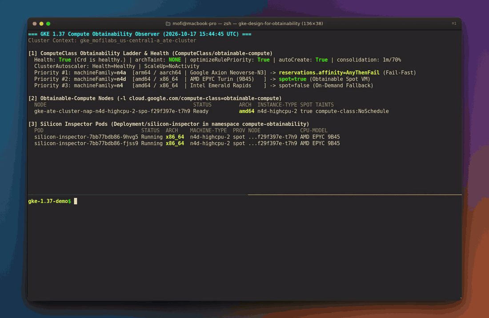
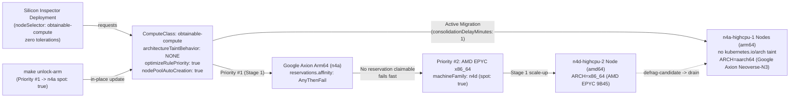
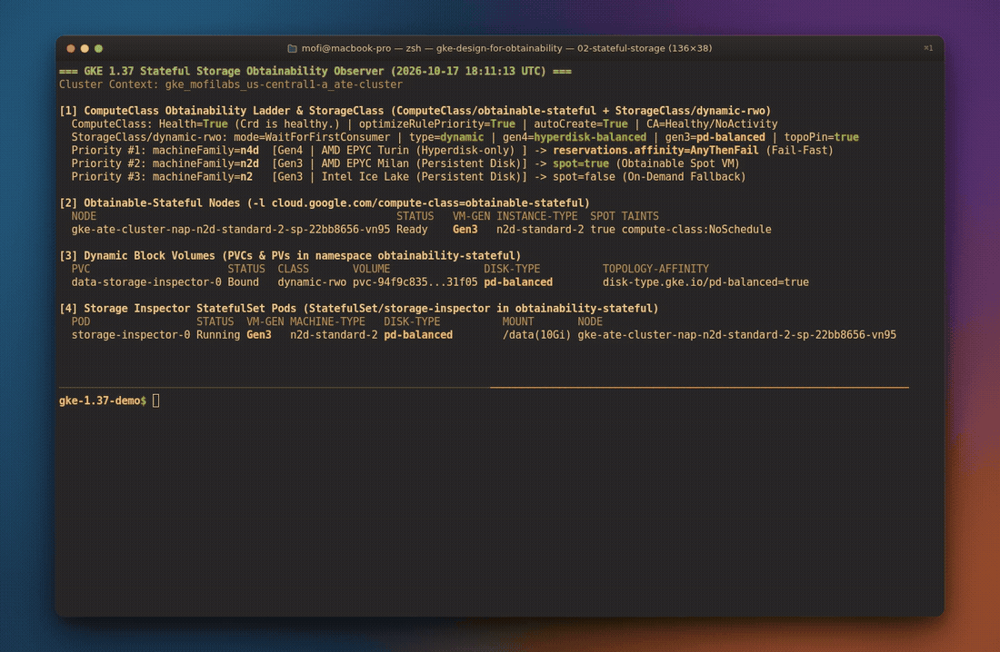
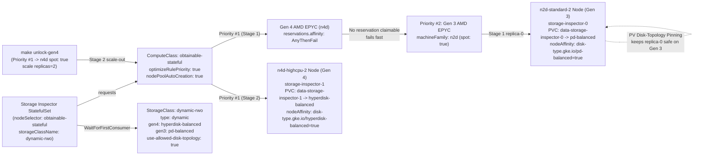

# Designing for compute obtainability on GKE 1.37

Zero-build reference repository for **Compute Obtainability** on GKE 1.37+ using Custom `ComputeClass` (`cloud.google.com/v1`), **Architecture Taint Suppression** (`taintConfig.architectureTaintBehavior: NONE`), **Fail-Fast Reservation Affinity** (`reservations.affinity: AnyThenFail`), **Node Pool Auto-Creation** (`nodePoolAutoCreation.enabled: true`), **Active Migration** (`activeMigration.optimizeRulePriority: true`), **Dynamic Block Storage Selection** (`StorageClass/dynamic-rwo`), and **PV Disk-Topology Pinning** (`use-allowed-disk-topology: "true"`).

This repository contains two self-contained, end-to-end live cluster demos:

| Demo | Focus | Namespace & Workload | Manifests | Full Walkthrough |
| :--- | :--- | :--- | :--- | :--- |
| **Demo 01 (`01-multi-arch`)** | Stateless cross-architecture obtainability & live migration across AMD EPYC `x86_64` (`n4d`) and Google Axion `arm64` (`n4a`) | `compute-obtainability` / `Deployment/silicon-inspector` (**Silicon Inspector**) | `manifests/01-multi-arch/` | [BLOG-01-MULTI-ARCH.md](BLOG-01-MULTI-ARCH.md) |
| **Demo 02 (`02-stateful-storage`)** | Stateful cross-generation obtainability across 3rd-Gen (`n2d` + `pd-balanced`) and 4th-Gen (`n4d` + `hyperdisk-balanced`) VMs with `dynamic-rwo` | `obtainability-stateful` / `StatefulSet/storage-inspector` (**Storage Inspector**) | `manifests/02-stateful-storage/` | [BLOG-02-STATEFUL-STORAGE.md](BLOG-02-STATEFUL-STORAGE.md) |

For production edge cases and operational lessons across both demos, see [TROUBLESHOOTING.md](TROUBLESHOOTING.md), [GLOSSARY.md](GLOSSARY.md), and the architecture decision records in [`docs/adr/`](docs/adr/).

## Prerequisites

1. A GKE cluster running version `1.37` or later, verified on `v1.37.0-gke.3503000`.
2. `kubectl` and `make` configured locally. Every `Makefile` target accepts `KUBE_CONTEXT=<your-context>`.

No custom container builds, Dockerfiles, or reserved capacity are required to run either demo.

## Demo 01: Multi-architecture silicon obtainability (`01-multi-arch`)

An unmodified multi-architecture **Silicon Inspector** workload (`alpine:3.20`) starts by failing fast past an unclaimable reservation (`reservations.affinity: AnyThenFail`), lands on AMD EPYC `x86_64` (`n4d-highcpu-2` Spot), and live-migrates onto Google Axion `aarch64` (`n4a-highcpu-1` Spot) via **Active Migration** (`optimizeRulePriority: true`) and **Architecture Taint Suppression** (`architectureTaintBehavior: NONE`) with zero Pod spec changes or architecture `tolerations`.

Read the full walkthrough in [BLOG-01-MULTI-ARCH.md](BLOG-01-MULTI-ARCH.md).



*Watch the high-resolution MP4 recording: [assets/01-multi-arch-demo.mp4](https://github.com/moficodes/gke-design-for-obtainability/raw/main/assets/01-multi-arch-demo.mp4)*



### Run Demo 01 in four commands

```bash
# 1. Deploy Stage 1 (Priority #1 n4a AnyThenFail -> falls back to Priority #2 n4d x86_64 Spot)
make apply-multi-arch   # (or: make apply)

# 2. Watch the Obtainability Ladder and live Pod architectures (or: make status)
make watch-multi-arch   # (or: make watch)

# 3. Promote obtainable Google Axion Arm64 Spot to Priority #1 -> triggers Active Migration
make unlock-arm

# 4. Tear down Demo 01 resources
make clean-multi-arch
```

## Demo 02: Cross-generation stateful obtainability (`02-stateful-storage`)

When a `ComputeClass` **Obtainability Ladder** spans 4th-generation VMs (`n4d`, `n4`, `n4a`, `c4`, which only attach Google Cloud Hyperdisk) and 3rd-generation fallback VMs (`n2d`, `n2`, which only attach Persistent Disk), hardcoding `standard-rwo` (`pd-balanced`) or a static `hyperdisk-balanced` `StorageClass` breaks one side of the ladder.

Demo 02 pairs `ComputeClass/obtainable-stateful` with GKE's pre-installed `StorageClass/dynamic-rwo` (**Dynamic Block Storage Selection**, `volumeBindingMode: WaitForFirstConsumer`, `parameters.type: dynamic`, `use-allowed-disk-topology: "true"`). In Stage 1, `storage-inspector-0` (**Storage Inspector**) fails fast past an unclaimable Gen 4 `n4d` reservation, schedules onto a Gen 3 `n2d-standard-2` Spot node (`AMD EPYC 7B13`), and automatically binds to a `10Gi` `pd-balanced` volume (`disk-type.gke.io/pd-balanced=true`). In Stage 2 (`make unlock-gen4`), unlocking Gen 4 `n4d` Spot at Priority #1 and scaling to 2 replicas provisions a Gen 4 `n4d-highcpu-2` Spot node (`AMD EPYC 9B45`) and dynamically binds `data-storage-inspector-1` to `hyperdisk-balanced` (`disk-type.gke.io/hyperdisk-balanced=true`), while **PV Disk-Topology Pinning** keeps `storage-inspector-0` pinned safely to its Gen 3 `n2d-standard-2` node.

Read the full walkthrough in [BLOG-02-STATEFUL-STORAGE.md](BLOG-02-STATEFUL-STORAGE.md).



*Watch the high-resolution MP4 recording: [assets/02-stateful-storage-demo.mp4](https://github.com/moficodes/gke-design-for-obtainability/raw/main/assets/02-stateful-storage-demo.mp4)*



### Run Demo 02 in four commands

```bash
# 1. Deploy Stage 1 (Priority #1 n4d AnyThenFail -> falls back to Priority #2 Gen 3 n2d Spot with pd-balanced)
make apply-stateful

# 2. Watch the Stateful Obtainability observer (or: make status-stateful)
make watch-stateful

# 3. Unlock Priority #1 Gen 4 n4d Spot and scale StatefulSet/storage-inspector to 2 replicas
make unlock-gen4

# 4. Tear down Demo 02 resources (including PVCs)
make clean-stateful     # (or: make clean)
```

## Makefile targets

| Target | Command | What it does |
| :--- | :--- | :--- |
| `apply` / `apply-multi-arch` | `make apply` | Deploys Demo 01 Stage 1 (`manifests/01-multi-arch/01-computeclass-fallback.yaml` and `02-silicon-inspector.yaml`) |
| `unlock-arm` | `make unlock-arm` | Updates `ComputeClass/obtainable-compute` Priority #1 to obtainable `n4a` Arm64 Spot (`manifests/01-multi-arch/03-computeclass-obtainable-arm.yaml`) |
| `watch` / `watch-multi-arch` | `make watch` | Refreshes the Demo 01 **Compute Obtainability** observer every 5 seconds (`./hack/watch.sh`) |
| `status` / `status-multi-arch` | `make status` | Prints a one-shot Demo 01 observer snapshot (`./hack/watch.sh --once`) |
| `logs` / `logs-multi-arch` | `make logs` | Streams live stdout silicon reports from **Silicon Inspector** Pods |
| `verify` / `verify-multi-arch` | `make verify` | Runs `./hack/verify-e2e.sh` for Demo 01 Stage 1 fallback and Stage 2 `aarch64` **Active Migration** |
| `clean-multi-arch` | `make clean-multi-arch` | Deletes Demo 01 workload and `ComputeClass/obtainable-compute` |
| `apply-stateful` | `make apply-stateful` | Deploys Demo 02 Stage 1 (`manifests/02-stateful-storage/01-computeclass-fallback.yaml` and `02-storage-inspector.yaml`) |
| `unlock-gen4` | `make unlock-gen4` | Updates `ComputeClass/obtainable-stateful` Priority #1 to obtainable Gen 4 `n4d` Spot and scales `StatefulSet/storage-inspector` to `replicas=2` |
| `watch-stateful` | `make watch-stateful` | Refreshes the Demo 02 Stateful Storage Obtainability observer every 5 seconds (`./hack/watch-stateful.sh`) |
| `status-stateful` | `make status-stateful` | Prints a one-shot Demo 02 observer snapshot (`./hack/watch-stateful.sh --once`) |
| `logs-stateful` | `make logs-stateful` | Streams live stdout storage reports from **Storage Inspector** Pods |
| `verify-stateful` | `make verify-stateful` | Runs `./hack/verify-stateful-e2e.sh` for Demo 02 cross-generation stateful obtainability |
| `clean-stateful` | `make clean-stateful` | Deletes Demo 02 PVCs, workload, and `ComputeClass/obtainable-stateful` |
| `clean` | `make clean` | Runs both `clean-multi-arch` and `clean-stateful` |

## A few things to keep in mind

- **Suppressing the Arm64 taint keeps `ComputeClass` node isolation intact.** Setting `architectureTaintBehavior: NONE` removes `kubernetes.io/arch=arm64:NoSchedule` from Arm64 nodes in that `ComputeClass`, while GKE still applies `cloud.google.com/compute-class=obtainable-compute:NoSchedule`. Unrelated cluster workloads will not accidentally schedule onto those Arm64 nodes. See [TROUBLESHOOTING.md #1](TROUBLESHOOTING.md#1-architecturetaintbehavior-none-vs-cloudgooglecomcompute-class-isolation-taints) and [ADR-0001](docs/adr/0001-architecture-taint-none-over-pod-tolerations.md).
- **Use `AnyThenFail` when you want unused reservations to fall through to Spot.** With `reservations.affinity: AnyBestEffort`, an exhausted reservation on Priority #1 silently provisions On-Demand VMs of that same machine family instead of advancing to Priority #2 Spot VMs. Use `AnyThenFail` so Cluster Autoscaler immediately moves to the next rule in your **Obtainability Ladder**. See [TROUBLESHOOTING.md #2](TROUBLESHOOTING.md#2-reservationsaffinity-anythenfail-vs-anybesteffort-on-priority-1) and [ADR-0002](docs/adr/0002-anythenfail-reservation-for-deterministic-fallback-and-active-migration.md).
- **In-place `ComputeClass` priority updates wait for `consolidationDelayMinutes` before draining.** Updating `spec.priorities` triggers **Active Migration** automatically without editing your Deployment, after the consolidation timer expires and marks lower-priority nodes with `autoscaling.gke.io/defrag-candidate`. See [TROUBLESHOOTING.md #3](TROUBLESHOOTING.md#3-in-place-active-migration-timing-defrag-candidate-taints-and-gke_metadata-node-labels) and [ADR-0003](docs/adr/0003-in-place-active-migration-and-defrag-lifecycle.md).
- **Pair cross-generation `ComputeClass` ladders with `StorageClass/dynamic-rwo` for stateful workloads.** 4th-generation VMs (`n4d`, `n4`, `n4a`, `c4`) only attach Hyperdisk while 2nd- and 3rd-generation VMs (`n2d`, `n2`, `e2`) only attach Persistent Disk. `dynamic-rwo` uses **Dynamic Block Storage Selection** (`WaitForFirstConsumer`, `type: dynamic`) to pick `hyperdisk-balanced` on Gen 4 or `pd-balanced` on Gen 3, and stamps **PV Disk-Topology Pinning** (`disk-type.gke.io/<disk-type>: "true"`) onto each PV so **Active Migration** never strands bound replicas across incompatible VM generations. See [TROUBLESHOOTING.md #4](TROUBLESHOOTING.md#4-cross-generation-stateful-storage-with-dynamic-rwo-pv-disk-topology-pinning-and-podantiaffinity) and [ADR-0004](docs/adr/0004-dynamic-rwo-and-pv-topology-pinning-across-vm-generations.md).

## Repository layout

- **`manifests/01-multi-arch/`**: Stage 1 `01-computeclass-fallback.yaml`, `02-silicon-inspector.yaml`, and Stage 2 `03-computeclass-obtainable-arm.yaml` for Demo 01.
- **`manifests/02-stateful-storage/`**: Stage 1 `01-computeclass-fallback.yaml`, `02-storage-inspector.yaml`, and Stage 2 `03-computeclass-obtainable-gen4.yaml` for Demo 02.
- **`hack/`**: Terminal observers (`watch.sh`, `watch-stateful.sh`) and verification suites (`test-stage1-fallback.sh`, `verify-e2e.sh`, `test-stage1-stateful.sh`, `verify-stateful-e2e.sh`, `test-docs.sh`).
- **`assets/`**: Live cluster demo recordings for Demo 01 (`01-multi-arch-demo.{mp4,gif}`) and Demo 02 (`02-stateful-storage-demo.{mp4,gif}`).
- **`BLOG-01-MULTI-ARCH.md` & `BLOG-02-STATEFUL-STORAGE.md`**: Engineering blog posts for Demo 01 and Demo 02.
- **`TROUBLESHOOTING.md`, `GLOSSARY.md`, & `docs/adr/`**: Production troubleshooting guide, canonical domain vocabulary, and `ADR-0001` through `ADR-0004`.
